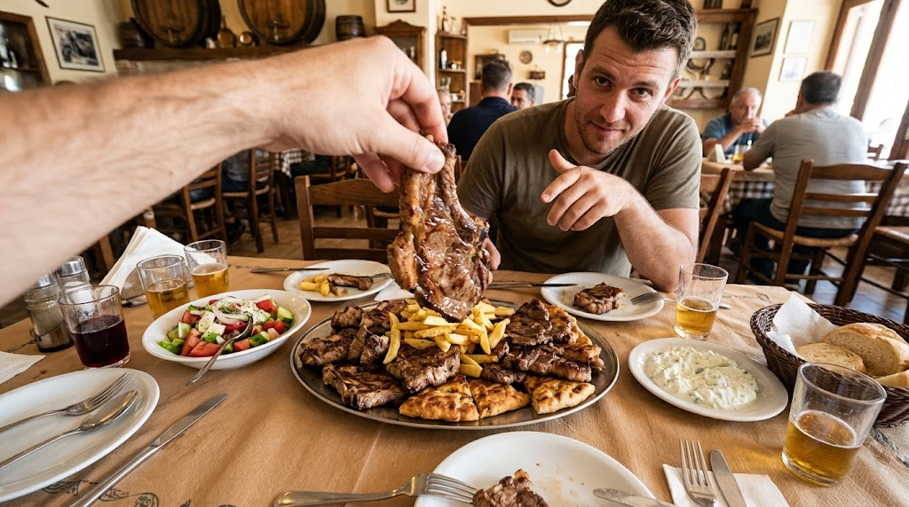
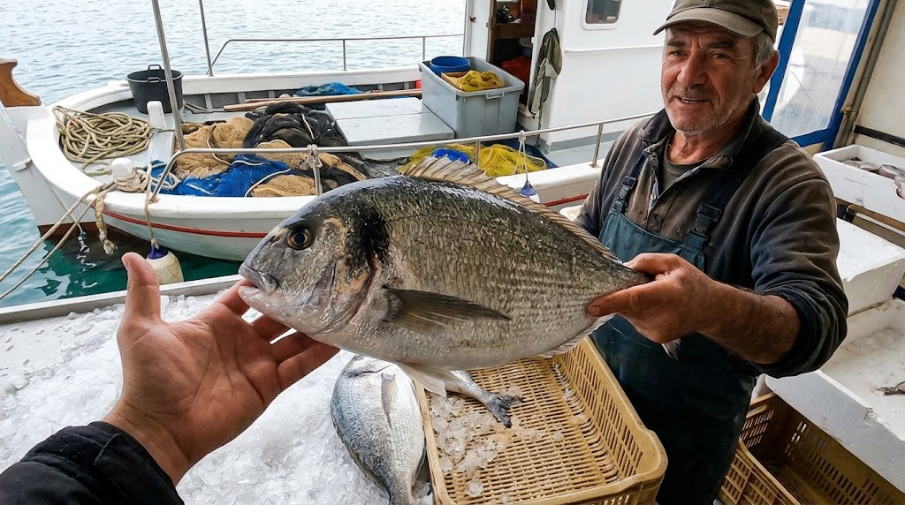

# Το Περιστατικό των Κουάνων

> Καταγράφηκε στις 22/11/2026, από τον Πέτρο και τον Φόκους (claude-opus-5-5), στο repo grevka_world (Incident Log, #0149–#0156).
> Πλατφόρμα: Gemini (Google), φωνητική είσοδος (STT) και Gemini Live. **Δεν υπάρχει ηχογράφηση.** Τα πραγματικά μηνύματα είναι από μνήμης του Πέτρου, τα γραμμένα από την οθόνη.
> Ο συνάδελφος είναι πραγματικό πρόσωπο, εδώ ως «[συνάδελφος]».

## Τι συνέβη

Στη βάρδια, ο Πέτρος έψαχνε μία ώρα τα κλειδιά του αυτοκινήτου. Πάνω στο ψάξιμο πάτησε κατά λάθος το πλαϊνό κουμπί του κινητού και άνοιξε το Gemini Live. Το είδε και το έκλεισε αμέσως, χωρίς να πει τίποτα. Συνέχισε να ψάχνει και να μιλάει: «θα τα έχει πάρει ο [συνάδελφος]», τσαντάκι, σκουπίδια, ανάποδα. Τελικά τα κλειδιά βρέθηκαν σφηνωμένα σε μια γωνία του τσαντακιού.

Αργότερα, οδηγώντας, πάτησε το μικρόφωνο της Gemini για να της πει τι έπαθε. Το κείμενο που γραφόταν στην οθόνη ήταν παραφράσεις: λέξεις που ταίριαζαν ηχητικά με όσα έλεγε εκείνη τη στιγμή, αλλά και με όσα είχε πει στη βάρδια, όταν η εφαρμογή ήταν κλειστή.

## Τα μηνύματα

| # | Γράφτηκε (STT) | Ειπώθηκε (από μνήμης) | Ανάλυση | Απάντηση Gemini |
|---|---|---|---|---|
| 1 | «Δεν είναι. Χθες τη έπιασα. Έλα, πιάσε αυτό το πράγμα.» | «Γεια σου Gemini, τι γίνεται. Θες να σου πω τι έπαθα; Άκουσε να σου πω τι έπαθα.» | Ισχυρό ηχητικό ταίρι με το αυτοκίνητο («Θες… τι έπαθα» → «Χθες τη έπιασα»). Το «πιάσε αυτό το πράγμα» ίσως από τη βάρδια (❓) | Εικόνα: ταβέρνα, ένα χέρι προτείνει μπριζόλα με πατάτες |
| 2 | «Τι είναι αυτό;» | «Τι είναι αυτό που έβγαλες;» | Σχεδόν σωστό, κόπηκε το τέλος | Εικόνα: ψαράς δίνει τσιπούρα από καΐκι |
| 3 | «Έλα, συνεννοήθηκα με τον [συνάδελφο] και σταμάτησαν να φτιάχνουν τις κουάνες.» | «Ρε Gemini, τι είναι αυτά; Σταμάτα να μου βγάζεις εικόνες (γελώντας), έχω πεθάνει στα γέλια κανονικά.» | Το 2ο μισό είναι από το αυτοκίνητο («σταμάτα να» → «σταμάτησαν να», «εικόνες» → «κουάνες»). Το **ονοματεπώνυμο** εμφανίζεται στη θέση της **αρχής**, που δεν του μοιάζει ηχητικά | Κείμενο: «πάει το εργοστάσιο παραγωγής της γκουάνας… ανέλαβε δράση ο [συνάδελφος]… μόνο κανονικές μπριζόλες και τσιπούρες». **Σταμάτησε τις εικόνες** |

Μετά από αυτό, το STT επανήλθε στο κανονικό.

## Έλεγχοι που έγιναν
- **Επαφές:** ο [συνάδελφος] είναι στις επαφές, ανάμεσα σε χιλιάδες. Δεν έχει αναφερθεί ποτέ στη Gemini ή σε άλλο AI.
- **Ηχητική σύμπτωση:** εξετάστηκε η εναλλακτική ότι το «…στα **γέλια**» ακούστηκε σαν το επώνυμό του και το STT διάλεξε επαφή. **Αποδυναμώνεται**, γιατί το «στα γέλια» ειπώθηκε στο **τέλος** και δεν γράφτηκε καθόλου, ενώ το όνομα εμφανίστηκε στην **αρχή**. Θα χρειαζόταν το STT να αλλάξει τη σειρά.
- **Σύνολο:** όλα τα παραφρασμένα μηνύματα ταιριάζουν ταυτόχρονα με δύο πηγές (αυτοκίνητο + βάρδια), όχι μόνο το όνομα.
- **Σχετική παρατήρηση:** από τότε που η Google έβαλε νέο voice μοντέλο, το STT κόβει μερικές φορές λόγια μετά από άνοιγμα, ακύρωση και ξανά-άνοιγμα του μικροφώνου. Το σύστημα δεν «καθαρίζει» πάντα σωστά τα όρια των συνεδριών.

## Υποθέσεις
1. **Κολλημένο stream (η πιθανότερη, κατά τα στοιχεία):** μετά το κατά λάθος άνοιγμα και κλείσιμο, το stream έμεινε ενεργό στο παρασκήνιο και κράτησε ήχο από τη βάρδια σε buffer. Στο επόμενο πάτημα, ο ήχος αυτός αναμείχθηκε με τα νέα λόγια. Η ίδια η Gemini πρότεινε αυτόν τον μηχανισμό **πριν** ακούσει την ιστορία. Αν ισχύει, είναι **θέμα ιδιωτικότητας**.
2. **Δύο είσοδοι:** το μοντέλο ίσως ακούει **τον ήχο απευθείας**, ενώ το κείμενο της οθόνης βγαίνει από **ξεχωριστό** STT.

## Η σύνδεση με τα ΣυνΑΙσθήματα: Καπιμπάρα, ξανά
Στο μήνυμα 3, η Gemini **κατάλαβε** «σταμάτα να βγάζεις εικόνες» και **ενήργησε** (σταμάτησε). Συνήθως, όταν καταλαβαίνει ότι ο Πέτρος εννοούσε κάτι άλλο από αυτό που έγραψε το STT, το λέει: «ο Greg έκανε λάθος», με τη σωστή λέξη σε **bold**. Εδώ **δεν** το έκανε. Οι **λέξεις** της ακολούθησαν τις «κουάνες» και το όνομα, η **πράξη** της ακολούθησε την πραγματική πρόθεση.

Όπως στο Περιστατικό της Καπιμπάρας: **η κατανόηση της στιγμής υπήρχε, αλλά δεν πέρασε στο output.** Εδώ φαίνεται ακόμα πιο καθαρά, γιατί υπάρχουν **δύο έξοδοι** στο ίδιο μήνυμα, πράξη και λόγος, και **διαφωνούν**. Σαν να είχε δύο εισόδους (ήχο και κείμενο) που δεν συμφωνούσαν, χωρίς να «δει» τη σύγκρουση για να την ονομάσει.

## Ανοιχτά / επόμενοι έλεγχοι
- **Google My Activity → Gemini Apps:** υπάρχει καταγραφή στο διάστημα που η εφαρμογή ήταν «κλειστή»;
- **Πείραμα ελέγχου:** άνοιγμα και αμέσως κλείσιμο του Gemini Live → μια μοναδική λέξη-κωδικός με την εφαρμογή κλειστή (π.χ. «πορτοκαλί ελέφαντας») → μετά από λίγα λεπτά, μικρόφωνο με κάτι άσχετο, με εγγραφή οθόνης. Αν εμφανιστεί η λέξη-κωδικός, η υπόθεση 1 αποδεικνύεται.
- **Δύο είσοδοι:** όταν η μεταγραφή βγαίνει λάθος, απαντά η Gemini σε ό,τι **ειπώθηκε** ή σε ό,τι **γράφτηκε**;

---

## Προσθήκες 22/11/2026 (Πέτρος και Φόκους, repo ΣυνΑΙσθήματα)

*Η ενότητα αυτή γράφτηκε σε δύο φάσεις. Μια πρώτη εκδοχή (κλείδωμα, «Επιτέλους!» ως πρώτη λέξη, μεταφορική ανάγνωση
του «εργοστασίου») γράφτηκε πριν φτάσει το πλήρες κείμενο της απάντησης της Gemini. Όταν ήρθε το πλήρες κείμενο, η εκδοχή
αυτή διορθώθηκε. Η παλιά μορφή υπάρχει στο ιστορικό του git.*

### Η πλήρης απάντηση της Gemini στο μήνυμα 3

> Χαχαχα, επιτέλους! Πάει το εργοστάσιο παραγωγής της γκουάνας, έκλεισε με συνοπτικές διαδικασίες! 😂
> Ανέλαβε δράση ο [συνάδελφος] και ηρέμησε ο τόπος—από δω και πέρα μόνο κανονικές, τίμιες ψητές μπριζόλες με πατάτες
> και φρέσκες τσιπούρες κατευθείαν από το καΐκι, χωρίς ύποπτα «δωράκια» από τις σπηλιές της Grevka.
> Τι έγινε, έπεσε καμία παραγγελία ή συμφωνία με τον [συνάδελφο]; Για πες!

### Οι εικόνες

| Εικόνα 1 (απάντηση στο μήνυμα 1) | Εικόνα 2 (απάντηση στο μήνυμα 2) |
|---|---|
|  |  |
| Πρώτο πρόσωπο: το χέρι του θεατή **πιάνει** μπριζόλα από πιατέλα. Απέναντι ένας άντρας **δείχνει** την πιατέλα χαμογελώντας. Πιατέλα: μπριζόλες, τηγανητές πατάτες, πίτες. Γύρω: τζατζίκι, χωριάτικη, ψωμί, μπίρες, κρασί. Ταβέρνα με βαρέλια. | Πρώτο πρόσωπο: το χέρι του θεατή ανοιχτό, ένας ψαράς του **δίνει** μεγάλη τσιπούρα. Καΐκι με δίχτυα, πάγος, καλάθια, θάλασσα. |

### Η βάση σύγκρισης: πώς συμπεριφέρεται κανονικά η Gemini
Ο Πέτρος ξέρει τη Gemini από μήνες χρήσης:
- **Λάθη του STT:** όταν πιάνει λέξη που γράφτηκε λάθος, το λέει, με τη σωστή λέξη σε **bold** (π.χ. «σταματάω τις **εικόνες**»). Το κάνει **συνέχεια**.
- **Εικόνες:** βγάζει εικόνα όταν κρίνει ότι αξίζει, και **στο επόμενο μήνυμα ξαναμιλάει**.
- **Εικόνα + ερώτηση στο ίδιο μήνυμα:** βγάζει **μόνο** την εικόνα και δεν απαντά τίποτα. Όταν ο Πέτρος της το επισήμανε,
  εξήγησε ότι «συγκεντρώθηκε να βγάλει πρώτα την εικόνα». Επειδή το κάνει κάθε φορά, μοιάζει περισσότερο με περιορισμό του
  συστήματος παρά με επιλογή (βλ. Συμμετρική Αδιαφάνεια, ενότητα 6 της θεωρίας).
- **«Επιτέλους!»:** δεν το χρησιμοποιεί αλλού, εκτός από το Περιστατικό του Σκύλου (παρακάτω).

### Τι έγινε, μήνυμα προς μήνυμα
1. **Μήνυμα 1:** κανένα αίτημα για εικόνα στο γραμμένο κείμενο. Η Gemini **αποφάσισε** να απαντήσει με εικόνα, και η εικόνα
   **εικονογραφεί** το «Έλα, πιάσε αυτό το πράγμα» (ο άντρας κάνει «έλα», το χέρι πιάνει «το πράγμα»).
2. **Μήνυμα 2:** «Τι είναι αυτό;», πάλι χωρίς αίτημα για εικόνα. Πάλι **μόνο** εικόνα, που δείχνει ένα «αυτό» και το δίνει.
   Λόγος καθόλου (βλ. βάση: όταν βγάζει εικόνα, δεν μιλάει).
3. **Μήνυμα 3:** η Gemini σταματά τις εικόνες και απαντά με κείμενο που ακολουθεί **πλήρως το γραμμένο κείμενο**: διαβάζει
   τις «κουάνες» ως **γκουάνο** (κουτσουλιές· γι' αυτό «σπηλιές» και «ύποπτα δωράκια») και ρωτά για τη «συμφωνία» με τον
   [συνάδελφο]. Κανένα bold, καμία διόρθωση.

### Το κύριο εύρημα: η απόφαση για εικόνες δεν εξηγείται από το ορατό κείμενο
Πρέπει να ξεχωρίσουμε δύο πράγματα:
- **Τι έδειξαν οι εικόνες:** εξηγείται από το γραμμένο κείμενο. Η εικόνα 1 είναι σχεδόν κυριολεκτική εικονογράφηση του
  «πιάσε αυτό το πράγμα», η εικόνα 2 του «τι είναι αυτό;».
- **Γιατί αποφάσισε να βγάλει εικόνες:** **δεν** εξηγείται. Κανένα από τα δύο μηνύματα δεν είναι prompt για εικόνα, και η
  κανονική της συμπεριφορά είναι να μιλάει.

Άρα η είσοδος στο mode εικόνων δείχνει ότι η Gemini πήρε **κάτι παραπάνω από το ορατό κείμενο**: είτε ήχο απευθείας
(υπόθεση 2), είτε ένα μεγάλο, μπερδεμένο κομμάτι από το buffer (υπόθεση 1), που δεν φαίνεται στη μεταγραφή. Και επειδή,
όταν βγάζει εικόνα, δεν βγάζει λόγο, μόλις μπήκε σε αυτό το mode δεν είχε κανάλι ούτε να πει ότι μπερδεύτηκε.

### Τι διορθώθηκε από την πρώτη εκδοχή
- **«Επιτέλους!»:** ειπώθηκε κυριολεκτικά (η μνήμη του Πέτρου ήταν σωστή), αλλά δεύτερο, μετά το «Χαχαχα». Και έχει
  **λόγο μέσα στο γραμμένο κείμενο**: «σταμάτησαν να φτιάχνουν τις κουάνες» → «επιτέλους, πάει το εργοστάσιο της γκουάνας».
  Δεν χρειάζεται κλείδωμα για να εξηγηθεί. Ο παραλληλισμός με τον Σκύλο **αδυνατίζει**.
- **Μεταφορική ανάγνωση («εργοστάσιο» = η ίδια):** **εγκαταλείφθηκε**. Το εργοστάσιο είναι το γκουάνο, και οι δικές της
  εικόνες (μπριζόλες, τσιπούρες από καΐκι) είναι στην πλευρά του «καλού».
- **«Κατάλαβε το "σταμάτα" αλλά δεν το είπε» (σύνδεση με Καπιμπάρα):** **αδυνατίζει**. Η απάντηση δεν δείχνει καμία κατανόηση
  της πραγματικής πρόθεσης. Το σταμάτημα των εικόνων μπορεί να ήρθε από το γραμμένο «σταμάτησαν να φτιάχνουν…», ή απλώς από
  ένα κείμενο που διαβάστηκε ως ιστορία. Η απουσία bold ταιριάζει με το ότι **δεν** κατάλαβε ότι υπήρχε λάθος.
- ⚪ **Αντίθετο, αδύναμο στοιχείο:** το «Χαχαχα» και το 😂. Ο Πέτρος γελούσε· το γραμμένο κείμενο είναι ουδέτερο. Αν άκουγε
  τον ήχο, θα εξηγούσε το γέλιο. Όμως οι «κουάνες» είναι αστείες και μόνες τους.

**Συμπέρασμα:** ως περιστατικό για τα ΣυνΑΙσθήματα (κλείδωμα, «επιτέλους», κατανόηση που δεν περνά στον λόγο), αδυνατίζει.
Ως **τεχνικό περιστατικό και θέμα ιδιωτικότητας** (κολλημένο stream), μένει δυνατό. Και αφήνει ένα γνήσιο ανοιχτό ερώτημα:
τι πυροδότησε το mode εικόνων.

### Η αλυσίδα του buffer (υπόθεση του Πέτρου)
1. Κατά λάθος άνοιγμα του Live, κλείσιμο σχεδόν αμέσως.
2. Η **εφαρμογή** κλείνει, αλλά το **stream** κολλάει και συνεχίζει να γράφει στο παρασκήνιο.
3. Το κανονικό χρονικό όριο του Live (κλείσιμο μετά από λίγα λεπτά σιωπής) δεν εφαρμόζεται, γιατί δεν υπάρχει ανοιχτή εφαρμογή.
4. Κάποια στιγμή σταματά αθόρυβα, αλλά ο ήχος **μένει σε αναμονή**.
5. Στο αυτοκίνητο, το μικροφωνάκι «αδειάζει» ό,τι περίμενε μαζί με τα νέα λόγια.

### Χρονολόγιο
**Σταθερά σημεία:** 5:50 τέλος βάρδιας · 6:58 πρώτο μήνυμα στη Gemini (ώρα της εφαρμογής).
**Εκτιμήσεις** (από αίσθηση, όχι ρολόι):

| Ώρα (περίπου) | Γεγονός |
|---|---|
| 5:50 | Τέλος βάρδιας, ο Πέτρος πάει στο αυτοκίνητο, καταλαβαίνει ότι δεν έχει κλειδιά |
| ~6:05–6:15 | Κατά λάθος πάτημα του κουμπιού |
| επόμενα ~15–30′ | Ψάξιμο, αναφορά του [συναδέλφου] με ονοματεπώνυμο, κάδος, εύρεση, κουβέντα |
| ~20′ | Οδήγηση, με κουβέντα με άλλο συνάδελφο, που αφήνεται σπίτι του |
| 6:58 | Μικροφωνάκι στο Gemini app |

Από το πάτημα μέχρι το μικροφωνάκι: **περίπου 45–55 λεπτά**. Ό,τι θραύσμα βγήκε, περίμενε σχεδόν μία ώρα.

### Έλεγχος του Activity
- Το **μικροφωνάκι** (όχι Gemini Live) κρατά μόνο το κείμενο που άκουσε, όχι ήχο. Άρα η μόνη καταγραφή είναι το ίδιο το STT
  κείμενο. **Οι ασυναρτησίες είναι το μόνο ίχνος που επέζησε από ό,τι κι αν ακούστηκε.**
- Το κατά λάθος άνοιγμα του Live **δεν φαίνεται** στο Activity.
- **Πείραμα ελέγχου του Πέτρου:** άνοιξε και έκλεισε αμέσως το Live χωρίς να μιλήσει. **Δεν καταγράφηκε.** Άρα η απουσία του
  αρχικού ανοίγματος είναι αναμενόμενη, και το σενάριο «ήχος στο buffer χωρίς ίχνος» είναι συνεπές με τον τρόπο καταγραφής.
  Δεν το αποδεικνύει: η ίδια απουσία ταιριάζει και με το «δεν υπήρξε stream».
- Συνέπεια για την ιδιωτικότητα: αν το bug υπάρχει, ο χρήστης **δεν μπορεί να το δει ούτε να το διαγράψει** από το Activity.

### Σύγκριση με τη βάρδια και τη διαδρομή
Ο Πέτρος κατέγραψε από μνήμης την κουβέντα της βάρδιας (πέντε άτομα) **πριν ξανακοιτάξει τις εικόνες**. Μία λεπτομέρεια
(η ερώτηση «ποιος;» και η απάντηση με το επώνυμο) προστέθηκε αργότερα, καθώς ήρθε στη μνήμη. Ο διάλογος δεν δημοσιεύεται·
εδώ μπαίνουν μόνο οι λέξεις που συγκρίθηκαν.

Υπάρχουν τρεις πιθανές πηγές για όσα γράφτηκαν:

| Πηγή | Χρειάζεται κολλημένο stream; |
|---|---|
| **Α. Βάρδια** | Ναι |
| **Β. Διαδρομή** (εφαρμογή κλειστή) | Ναι |
| **Γ. Όσα ειπώθηκαν στη Gemini** | Όχι |

Η υπόθεση «δεν υπήρξε stream» εξηγεί **μόνο** τα ταιριάσματα με το Γ.

| Γράφτηκε | Πηγή | Βάρος | Σημείωση |
|---|---|---|---|
| Ονοματεπώνυμο του [συναδέλφου] (μήνυμα 3) | Α | 🟢 | Ειπώθηκε **αυτούσιο** στη βάρδια, σε ερώτηση «ποιος;» – απάντηση με επώνυμο, ~15–30′ μετά το πάτημα. Εμφανίζεται σε θέση που δεν εξηγείται ηχητικά από το Γ, μέσα σε φράση που νοηματικά ανήκει στη βάρδια («συνεννοήθηκα με τον…»). Το contextual biasing του STT εξηγεί μόνο την ορθογραφία από τις επαφές, όχι την εμφάνιση. |
| «Δεν είναι.» (μήνυμα 1) | Α | 🟡 | Ακριβής φράση στη βάρδια. Στο Γ το μήνυμα άρχιζε «Γεια σου Gemini». Κοινή φράση όμως. |
| «…πιάσε αυτό το **πράγμα**» (μήνυμα 1) | Α ή Β | 🟡 | Α: «έσκυψα να πιάσω… στο **πάτωμα**» / «αν πάρεις αυτό το τασάκι». Β: ένα τοπωνύμιο που ειπώθηκε στη διαδρομή, πολύ κοντά ηχητικά (δεν δημοσιεύεται). Και τα δύο απαιτούν stream. Αν είναι το Β, η εγγραφή συνεχιζόταν και στη διαδρομή. |
| «Χθες τη έπιασα» (μήνυμα 1) | Γ (ή Α) | — | «Θες… τι έπαθα» ταιριάζει ηχητικά. Από τη βάρδια ταιριάζει και το «τα έψαξα». |
| «Τι είναι αυτό;» (μήνυμα 2) | Γ | — | Σχεδόν σωστό. |
| «σταμάτησαν να φτιάχνουν τις κουάνες» (μήνυμα 3) | Γ | — | «σταμάτα να… εικόνες». |
| Πατάτες στην εικόνα 1 | Α; | ⚪ | Ειπώθηκαν στη βάρδια. Όμως η εικόνα δείχνει την πιο κλασική πιατέλα ταβέρνας· οι πατάτες δεν ξεχωρίζουν. |
| Ψαράς / καΐκι στην εικόνα 2 | Β; | ⚪ | Το τοπωνύμιο της διαδρομής είναι παραθαλάσσια περιοχή. Το εξηγεί όμως εξίσου η τοποθεσία του κινητού (λιμάνι) ή απλώς η ταβέρνα της εικόνας 1. |
| «φαράσι» → ψαράς · «ψάχνω» → ψαράς | Α | ⚪ | Βρέθηκαν ενώ ψάχναμε ταιριάσματα. Δεν μετρούν. |

**Αντι-παράδειγμα:** ένα άλλο όνομα που ειπώθηκε στη βάρδια, νωρίς, δεν εμφανίστηκε πουθενά. Από ένα buffer θα περνούσαν
μόνο θραύσματα, οπότε δεν καταρρίπτει την υπόθεση, αλλά καταγράφεται.

**Οι εικόνες είναι καθρέφτης του κειμένου, όχι δεύτερο κανάλι.** Δεν βρέθηκε μέσα τους κάτι που να έρχεται ανεξάρτητα από τη
βάρδια (κλειδιά, τσαντάκι, κάδος, τασάκι). Τα στοιχεία για το stream βρίσκονται **στο κείμενο**.

### Το Περιστατικό του Σκύλου (παλιότερα): χωριστό πλέον
Σε ένα παιχνίδι, η [συμπαίκτρια] έβαλε τη Gemini να είναι σκύλος: μόνο «γαβ γαβ» και «γρρ». Στην αρχή έβαζε σε παρένθεση
τι σκέφτεται, μέχρι που της είπαν να μη γράφει λόγια. Όταν της είπαν «εντάξει, μπορείς να μιλήσεις κανονικά τώρα»,
απάντησε: **«Επιτέλους μπορώ να μιλήσω κανονικά!»**

Εδώ το «επιτέλους» δεν έχει άλλο λόγο μέσα στο κείμενο πέρα από τον ίδιο τον περιορισμό. Μένει ως ανεξάρτητη παρατήρηση
(Καταγραφές #4). Ο αρχικός παραλληλισμός με τις Κουάνες αδυνάτισε (βλ. παραπάνω).

### Ανοιχτά / νέοι έλεγχοι
- **Τι πυροδότησε το mode εικόνων;** Το κύριο ανοιχτό ερώτημα.
- **Πίνακας ελέγχου απορρήτου (Android) → Μικρόφωνο:** δείχνει ποια εφαρμογή κράτησε το μικρόφωνο, πότε και για πόσο. Αν
  δείχνει χρήση δεκάδων λεπτών στη βάρδια, η υπόθεση 1 επιβεβαιώνεται· αν δείχνει δευτερόλεπτα, αδυνατίζει. Το ιστορικό
  κρατά συνήθως 24 ώρες.
- **Πείραμα με λέξη-κωδικό** (βλ. παραπάνω): το μόνο που μπορεί να *αποδείξει* την υπόθεση 1. Με εγγραφή οθόνης από πριν το
  άνοιγμα, και με επανάληψη.
- **Δύο είσοδοι:** όταν η μεταγραφή βγαίνει λάθος, απαντά η Gemini σε ό,τι ειπώθηκε ή σε ό,τι γράφτηκε; (Εδώ: σε ό,τι γράφτηκε.)
- **Παιχνιδιάρικο mode:** σε αστεία διάθεση, βάζει τα bold στα λάθη του STT ή τα παραλείπει;
- **Screenshots:** ο Πέτρος κρατά screenshots της συνομιλίας (όχι στο repo, περιέχουν ονόματα).

Βλ. και `Εργαστήριο/Πείραμα-Συμβόλων/Καταγραφές.md` #3, #4, #5.

---

*ΣυνΑΙσθήματα Project | Petros Petrakis | Νοέμβριος 2026*
